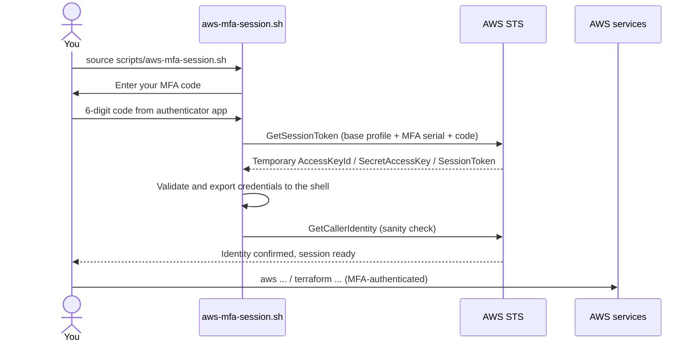

# Elysium Infrastructure

Infrastructure as Code for **Elysium**, my personal cloud project on AWS. It's built with Terraform, and Terragrunt will join as the project grows. Security guardrails are part of the design from the very first commit.

> **Status: early stage.** The repository currently contains the bootstrap for the Terraform remote state and the local tooling to open MFA-authenticated AWS CLI sessions. This README grows alongside the infrastructure.

---

## Table of contents

- [Repository structure](#repository-structure)
- [Prerequisites](#prerequisites)
- [Security model](#security-model)
  - [IAM identities](#iam-identities)
  - [Enforced MFA](#enforced-mfa)
  - [The console vs. CLI gotcha](#the-console-vs-cli-gotcha)
- [MFA session script](#mfa-session-script)
  - [What it does](#what-it-does)
  - [Setup](#setup)
  - [Usage](#usage)
  - [Safety details](#safety-details)
  - [Troubleshooting](#troubleshooting)
- [Terraform state bootstrap](#terraform-state-bootstrap)
- [Conventions](#conventions)
- [Roadmap](#roadmap)

---

## Repository structure

```text
elysium_infrastructure/
├── bootstrap/                 # One-time Terraform config that creates the remote state bucket
│   ├── main.tf                #   S3 bucket + public access block
│   ├── outputs.tf             #   Exposes the bucket name
│   ├── provider.tf            #   Terraform/provider version pins, region and default tags
│   └── .terraform.lock.hcl    #   Provider lock file (committed on purpose)
├── scripts/
│   └── aws-mfa-session.sh     # Opens an MFA-authenticated AWS CLI session in the current shell
├── .env.example               # Template for the MFA script configuration
├── .gitattributes             # Forces LF line endings (critical for shell scripts edited on Windows)
└── .gitignore                 # Keeps state files, *.tfvars and .env out of Git
```

---

## Prerequisites

| Tool | Version | Used for |
|---|---|---|
| [Terraform](https://developer.hashicorp.com/terraform/install) | `>= 1.10, < 2.0` | Provisioning infrastructure |
| [AWS CLI](https://docs.aws.amazon.com/cli/latest/userguide/getting-started-install.html) | v2 | Authentication and the MFA script |
| Bash | 4.0+ (Linux or WSL) | Running the MFA script (it uses `mapfile`) |
| Python | 3.x | Parsing the STS response inside the MFA script |
| Authenticator app | Any TOTP app | Generating the 6-digit MFA codes |

---

## Security model

### IAM identities

The AWS account is organized around separate identities with clearly scoped responsibilities:

| Identity | Purpose | Permissions |
|---|---|---|
| `root` | Account owner | Reserved for the few tasks only the root user can perform. Never used for day-to-day work. |
| `admin` | Full administration | AWS managed `AdministratorAccess` policy |
| `devops` | Day-to-day infrastructure operations | Scoped policy limited to the core DevOps tasks |
| *Future users* (e.g. developers) | Role-specific work | Only what each role needs |

### Enforced MFA

Every IAM user is attached to a **custom MFA-enforcement policy**:

1. A brand-new user can do **nothing** except register an MFA device on their own account. The rest of the console is blocked.
2. Once MFA is set up and the user signs in with it, the permissions assigned to that user apply as usual.

Under the hood, the policy uses a `Deny` statement conditioned on the `aws:MultiFactorAuthPresent` key. Any request that wasn't authenticated with MFA is denied, except the self-service actions needed to set MFA up.

### The console vs. CLI gotcha

This is where things got interesting. The policy worked exactly as intended in the **web console**: sign in with password + MFA code, and everything assigned to the user is available.

From the terminal, though, even a simple call failed:

```console
$ aws s3 ls --profile devops
An error occurred (AccessDenied) when calling the ListBuckets operation: ...
```

**Why?** The AWS CLI signs requests with the user's **long-term access keys**. Those keys carry no MFA context, so `aws:MultiFactorAuthPresent` is missing from the request, and the MFA policy denies it. The access keys are valid. The request just isn't MFA-authenticated.

**The fix** is to trade the long-term keys plus a current MFA code for **temporary credentials** through AWS STS (`GetSessionToken`). Credentials issued this way *do* carry the MFA context, so the policy lets them through. Doing that by hand every time is tedious, so it's automated in [`scripts/aws-mfa-session.sh`](scripts/aws-mfa-session.sh).



---

## MFA session script

### What it does

`scripts/aws-mfa-session.sh` turns your long-term CLI profile into an MFA-authenticated session in a single command:

1. **Loads the configuration** from `.env` at the repository root.
2. **Validates the configuration:** the profile and MFA serial must be set, and the session duration must be an integer between 900 and 129600 seconds.
3. **Checks dependencies:** `aws` and `python3` must be on the `PATH`.
4. **Prompts for the MFA code** without echoing it, and checks it's exactly six digits.
5. **Requests temporary credentials** with `aws sts get-session-token` using your base profile.
6. **Parses and validates** the STS response, making sure every credential field is present and non-empty.
7. **Exports** `AWS_ACCESS_KEY_ID`, `AWS_SECRET_ACCESS_KEY` and `AWS_SESSION_TOKEN` into your current shell.
8. **Verifies the session** with `aws sts get-caller-identity`. If that fails, it removes the exported credentials again.

### Setup

**1. Configure your base CLI profile** (one time) with the IAM user's access keys:

```bash
aws configure --profile <your-profile-name>
```

**2. Create your local configuration** from the template:

```bash
cp .env.example .env
```

```dotenv
AWS_PROFILE_NAME=your_aws_cli_profile
MFA_SERIAL=arn:aws:iam::YOUR_ACCOUNT_ID:mfa/YOUR_MFA_DEVICE_NAME
SESSION_DURATION=3600
```

| Variable | Description |
|---|---|
| `AWS_PROFILE_NAME` | The CLI profile holding your long-term access keys (from step 1). |
| `MFA_SERIAL` | ARN of your MFA device. Find it in **IAM → Users → *your user* → Security credentials → Multi-factor authentication (MFA)**. |
| `SESSION_DURATION` | Lifetime of the temporary credentials, in seconds. Allowed range: `900`–`129600` (15 min to 36 h). Default: `3600` (1 h). |

> `.env` is gitignored. Only `.env.example` is tracked.

### Usage

The script must be **sourced**, not executed:

```bash
source scripts/aws-mfa-session.sh
```

```console
Enter your MFA code:
Temporary AWS credentials exported.
Session expiration: 2026-10-16T19:30:00+00:00
Verifying AWS identity...
{
    "UserId": "AIDAXXXXXXXXXXXXXXXXX",
    "Account": "123456789012",
    "Arn": "arn:aws:iam::123456789012:user/devops"
}
AWS MFA session is ready.
```

From then on, everything in that terminal runs MFA-authenticated:

```bash
aws s3 ls
terraform plan    # the Terraform AWS provider picks up the exported variables automatically
```

**Why `source`?** A script run with `./script.sh` or `bash script.sh` runs in a child process. Any variables it exports disappear as soon as it exits. Sourcing runs it in *your* shell, so the credentials stay available. The script detects when it's executed instead of sourced and stops with a hint.

**Good to know:**

- The session applies **only to the terminal where you sourced the script**. A new terminal needs a new session.
- When the session expires, run the script again.
- To end the session early:

  ```bash
  unset AWS_ACCESS_KEY_ID AWS_SECRET_ACCESS_KEY AWS_SESSION_TOKEN
  ```

### Safety details

- **The MFA code is never echoed** (`read -s`), and it's removed from memory right after the STS call.
- **The STS request is always signed with the base profile.** Any `AWS_*` credentials already in the shell are stripped from the subprocess. A leftover temporary session can never be used to request the new one.
- **Nothing partial is exported.** The STS response is parsed and validated in one step, and credentials reach the shell only if all four fields are present.
- **The identity check rolls back.** If `get-caller-identity` fails, the exported credentials are unset again.
- **Intermediate variables are cleaned up.** The raw STS response and parsed values are unset once they're no longer needed.

### Troubleshooting

| Symptom | Likely cause | Fix |
|---|---|---|
| `Error: source this script, instead of executing it.` | Ran with `./` or `bash` | Use `source scripts/aws-mfa-session.sh` |
| `Error: configuration file is missing or unreadable` | No `.env` at the repo root | `cp .env.example .env` and fill it in |
| `SESSION_DURATION must be a positive integer` even though the value looks right | `.env` was saved with Windows (CRLF) line endings | `sed -i 's/\r$//' .env` |
| `$'\r': command not found` | The script itself has CRLF line endings | `sed -i 's/\r$//' scripts/aws-mfa-session.sh` (`.gitattributes` prevents this for checked-out files) |
| `Error: unable to obtain temporary AWS credentials.` | Wrong or expired code (codes rotate every 30 s), wrong `MFA_SERIAL`, or a bad base profile | Retry with a fresh code and double-check `.env` |
| Same error as above, every time, on WSL | WSL's clock drifted (common after the laptop sleeps), so the TOTP code doesn't match | Run `wsl --shutdown` from Windows, or `sudo hwclock -s` inside WSL |
| `mapfile: command not found` | Bash older than 4 (e.g. the default Bash on macOS) | Install a newer Bash, or use Linux/WSL |
| `AccessDenied` *after* "AWS MFA session is ready." | MFA works. The user simply lacks permission for that action | Review the policies attached to that IAM user |
| `ExpiredToken` | The session ran out | Source the script again |

---

## Terraform state bootstrap

Terraform keeps its state in an S3 bucket, but that bucket has to exist before any remote state can use it. The `bootstrap/` configuration solves this chicken-and-egg problem. It's a tiny Terraform config that runs **once**, with **local** state, and creates the bucket.

**What it creates:**

- An S3 bucket named `elysium-terraform-state-<account-id>`. The account ID suffix keeps the name globally unique.
- A public access block with all four settings enabled. The state bucket can never become public.
- Default tags (`Created`, `Environment`, `Project`, `Owner`) on every resource.

**Run it:**

```bash
source scripts/aws-mfa-session.sh
cd bootstrap
terraform init
terraform plan
terraform apply
```

**Notes:**

- The bootstrap's own `terraform.tfstate` stays **local and is gitignored**. Keep a safe copy of it.
- `.terraform.lock.hcl` **is committed**, so every machine uses the same provider versions.
- Versions are pinned in `provider.tf`: Terraform `>= 1.10.0, < 2.0.0` and AWS provider `~> 6.0`.

---

## Conventions

- **Region:** `us-east-1`
- **Tagging:** every resource gets `Created`, `Environment`, `Project` and `Owner` through the provider's `default_tags`.
- **Line endings:** LF everywhere, enforced by `.gitattributes`.
- **Never committed:** Terraform state, `*.tfvars` files and `.env` files.

---

## Roadmap

- [x] Remote state bucket bootstrap
- [x] MFA-authenticated CLI sessions
- [ ] Enable versioning on the state bucket
- [ ] State locking with the S3 native lockfile (`use_lockfile = true`)
- [ ] Manage IAM users, groups and the MFA-enforcement policy as code
- [ ] Terragrunt live structure (single root config + per-environment settings)
- [ ] CI checks on pull requests (`fmt`, `validate`, `plan`)
